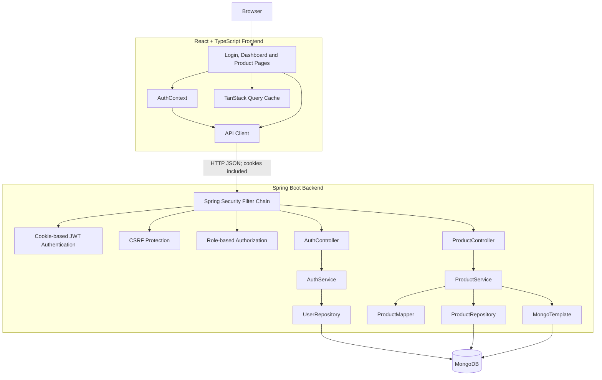

# Application Architecture

This diagram describes the React, Spring Boot, and MongoDB application architecture based on the current source implementation.

## Security boundaries

The frontend sends authenticated requests with browser-managed cookies. The backend resolves JWT authentication from cookies and applies CSRF protection to unsafe HTTP methods.

Spring Security enforces role-based authorization:

| Operation                                   | Required access |
| ------------------------------------------- | --------------- |
| Login and CSRF token retrieval              | Public          |
| Current user and logout                     | Authenticated   |
| Product listing and detail                  | USER or ADMIN   |
| Product creation, modification and deletion | ADMIN           |
| Product statistics                          | Authenticated   |

Authentication and authorization are enforced on the backend. Frontend role checks are user-interface controls, not substitutes for backend authorization. JWT authentication, CSRF validation, and authorization are conceptual responsibilities of the Spring Security processing chain, not independent network services.

## Scope

This is a logical component diagram, not a deployment topology. It does not assert that a reverse proxy, load balancer, external identity provider, or production infrastructure is deployed.
