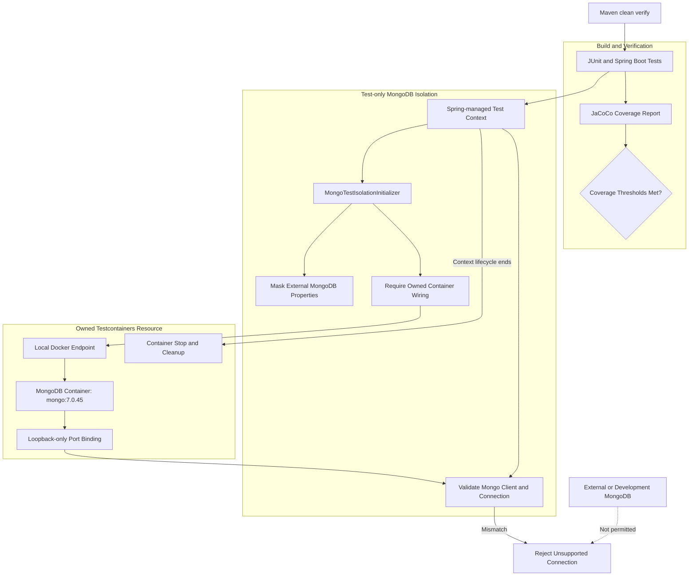

# Backend Test Isolation Architecture

This diagram describes the MongoDB integration-test isolation controls and Maven verification workflow.

## Isolation guarantees and boundaries

The test configuration requires an owned MongoDB container rather than relying on an externally supplied development database.

The isolation initializer masks MongoDB URI and database configuration and checks for the required container wiring.

The connection guard validates the MongoDB client settings against the owned container's resolved host and mapped port.

The container configuration:

- Uses the pinned `mongo:7.0.45` image.
- Disables container reuse.
- Binds the MongoDB port to `127.0.0.1` with a dynamically assigned host port.
- Requires a local Docker endpoint.
- Attempts cleanup if startup fails.

Spring manages the container lifecycle through the test application context, including context caching. Cleanup verification should therefore be distinguished from individual test-method completion.

## Coverage enforcement

The Maven build configures JaCoCo to attach its agent during initialization and generate reports and execute coverage checks during the `verify` phase.

The applicable coverage thresholds are defined in `backend/springreactdemo/pom.xml`. This diagram does not substitute for the Maven build's actual verification result.

## Verification evidence

For historical execution results and the verified I2/I3 scope, see:

- [QA Evidence Index](../qa/README.md)
- [Root README](../../README.md)
- [Test Codification Plan](../../TEST-CODIFICATION-PLAN.md)

This document describes the implemented test-isolation design. It does not claim that every future environment or build will pass its prerequisites.
